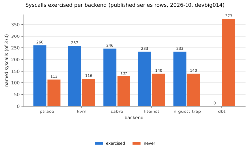

# Syscall coverage gaps — 2026-10-27

Owner request (Slack 2026-10-25, minibeads dh-te7ep): per-cell syscall
histograms on every validate, aggregated into coverage. This report is the
first coverage-gap list from the published series rows. Written by musesc
(Muse) for the coordinator to publish under dev-hermit `ai_docs/` or
`experiments/`.

## Provenance

| item | value |
|---|---|
| Hermit HEAD | `5f53234fbb0129114a34de8cb06dfdd7cde5d194` (includes slices `ca0912f5`, `3a561e52`, memory fix `b42d62e4`) |
| dev-hermit slice 3 | `139ee26e55607fac31ac2e90518977fc0030dbcd` (series projection + Syscalls page) |
| Published ledger | `rrnewton/hermit_test_ledger` at `8e26a81f28b9e58b0e780b4cbe992c2c4315d790` |
| Shards counted | `series/hermit/devbig014/2026-10.part-0036.jsonl`, `part-0037`, `part-0038` (49,873 rows, all October runs on devbig014) |
| Pinned names | 373, from `detcore-model/src/syscall_histogram.rs:487 pinned_syscall_table()` (syscalls 0.6.18, nr 0–461) |
| Data | `data/coverage_published.json`, `data/pinned_373.txt` beside this report |

## Histograms end to end: verified

1. **Validate `results.jsonl`** (newest full validate
   `validate-claude-coord-5f53234fbb01-1793092042298447644-3326064-1fe501a7`,
   2,298 rows): 1,787 rows carry `runtime.run1.syscall_histogram` and the
   same 1,787 carry `run2`, in the compact
   `[nr,calls,detcore,backend,refused]` form. DBT rows carry no `runtime`.
2. **Published series rows** (ledger above): rows carry
   `series.runtime.run1.syscall_histogram`, never a run-2 histogram — the
   shared-checker rule holds in published data. Per backend, histogram rows /
   all October rows: ptrace 4,796/17,907; kvm 4,516/11,234; sabre
   1,460/1,539; liteinst 2,481/6,599; in-guest-trap 2,479/6,585; dbt 0/6,009.
   For the newest validate run alone: ptrace 596, kvm 564, liteinst 308,
   in-guest-trap 307, dbt 0.
3. **No syscall-histogram refusals.** The series quarantine at the same
   ledger commit contains zero histogram reasons (see the companion
   quarantine report).
4. **Website.** The Syscalls page code is live on dev-hermit
   (`render_page.py:5288 _syscalls_page`, linked as "Syscalls"), and its
   admission rule (histogram calls must sum to run 1 `syscalls`) matches the
   published rows above, so the next Docs rebuild will show real counts.
   The live page itself could not be fetched from this sandbox on
   2026-10-27 (the approved fetch path timed out); treat the page check as
   **unverified until the next 08:23 UTC rebuild is opened once**.

## Coverage

| backend | scope | rows with histogram | exercised | never |
|---|---|---:|---:|---:|
| ptrace | complete | 4,796 | 260 | 113 |
| kvm | complete | 4,516 | 257 | 116 |
| sabre | partial | 1,460 | 246 | 127 |
| liteinst | partial | 2,481 | 233 | 140 |
| in-guest-trap | partial | 2,479 | 233 | 140 |
| dbt | none | 0 | 0 | 373 |

Union across backends: **260 exercised, 113 never exercised anywhere.**
Complete-scope union (ptrace+kvm) is 260; the partial backends add no
syscall the complete ones miss in this corpus. Intersection of the five
histogram backends is 232 (from the spool prelim). DBT is the explicit
denominator gap: 6,009 October rows with no histogram at all (handoff
follow-up 2 — DBT has no `--summary-json`).

### Never exercised anywhere (113)

`rt_sigreturn, select, shmat, shmctl, semop, semctl, shmdt, msgsnd, msgrcv,
msgctl, getdents, setuid, setgid, setreuid, setregid, setgroups, setfsuid,
setfsgid, utime, mknod, uselib, sched_setparam, sched_getparam,
sched_setscheduler, sched_get_priority_max, sched_get_priority_min,
sched_rr_get_interval, mlock, mlockall, vhangup, modify_ldt, pivot_root,
_sysctl, chroot, sync, settimeofday, mount, umount2, swapon, swapoff,
reboot, sethostname, setdomainname, iopl, ioperm, create_module,
init_module, delete_module, get_kernel_syms, query_module, quotactl,
nfsservctl, getpmsg, putpmsg, afs_syscall, tuxcall, security, tkill,
set_thread_area, io_cancel, get_thread_area, lookup_dcookie,
epoll_ctl_old, epoll_wait_old, restart_syscall, semtimedop,
timer_getoverrun, clock_settime, utimes, vserver, mbind, mq_open,
mq_unlink, mq_timedsend, mq_timedreceive, mq_notify, mq_getsetattr,
kexec_load, inotify_init, migrate_pages, futimesat, unshare, signalfd,
eventfd, timerfd_gettime, fanotify_init, fanotify_mark, open_by_handle_at,
sendmmsg, setns, finit_module, kexec_file_load, mlock2, pkey_mprotect,
pkey_alloc, pkey_free, io_pgetevents, pidfd_send_signal, open_tree,
move_mount, fsopen, fsconfig, fsmount, fspick, pidfd_getfd,
process_madvise, mount_setattr, quotactl_fd, landlock_create_ruleset,
landlock_add_rule, landlock_restrict_self, set_mempolicy_home_node,
futex_wait`

Most are privileged, legacy, or container-excluded calls (mount family,
module loading, SysV IPC, POSIX message queues, landlock, fsconfig family)
that the corpus guests have no reason to issue. The actionable subset is
the LinuxEmu cross below.

### Cross with LinuxEmu (`ai_docs/2026-10-25-linuxemu-scope.md` §4)

The LinuxEmu table has 374 rows; the 374th is `mseal` (nr 462), one past
the pinned table's 462 slots — that is the whole 374-vs-373 difference.

- **Never exercised, but LinuxEmu implements or holds in scope (40):**
  `rt_sigreturn` (Implemented), `select` (Implemented), `mknod`
  (Implemented), `tkill` (Implemented), `eventfd` (Implemented),
  `timerfd_gettime` (Implemented), `sched_get_priority_max/min` (Partial),
  `inotify_init` (Partial), `signalfd` (Partial), and 30
  "Not implemented (in scope)": the SysV IPC family (`shmat`, `shmctl`,
  `semop`, `semctl`, `shmdt`, `msgsnd`, `msgrcv`, `msgctl`, `semtimedop`),
  POSIX message queues (`mq_open`, `mq_unlink`, `mq_timedsend`,
  `mq_timedreceive`, `mq_notify`, `mq_getsetattr`), `getdents`, `utime`,
  `utimes`, `futimesat`, `sync`, `sched_rr_get_interval`, `io_cancel`,
  `restart_syscall`, `timer_getoverrun`, `sendmmsg`, `io_pgetevents`,
  `pidfd_send_signal`, `pidfd_getfd`, `process_madvise`, `futex_wait`.
  These are the coverage targets worth a guest each; the Implemented five
  are the cheapest wins because the handler exists and only lacks a cell.
- **Exercised on KVM, but LinuxEmu refuses or holds out of scope (52):**
  the Detcore-decides set (`getuid`, `geteuid`, `getgid`, `getegid`,
  `getpgrp`, `getresuid`, `getresgid`, `getrandom`, `prlimit64`,
  `sched_getaffinity`, `sched_getattr`, `sched_setattr`,
  `sched_getscheduler`, `setresuid`, `setresgid`, `setpriority`,
  `getpriority`, `membarrier`, `seccomp`, `getcpu`, `ioprio_get/set`) —
  exercised precisely because Detcore answers them on every backend — plus
  out-of-scope calls the corpus issues anyway (`rseq` refused, `ptrace`,
  `bpf`, `perf_event_open`, `kcmp`, `openat2` is not in this set, key/mount
  introspection family). No action: this direction is expected layering,
  not a gap.

### Outcome mix

- **Always refused (≥100 calls, 100% refused):** `rseq` (23,772 calls —
  glibc issues it and Detcore refuses it by design), `ptrace` (175),
  `kcmp` (140), `openat2` (124), `perf_event_open` (105),
  `remap_file_pages` (105), `cachestat` (105). `copy_file_range` is 52%
  refused (70/134).
- **Detcore-only (49):** answered by Detcore in every observed call —
  identity/time/virtualized calls (`getuid`, `getgid`, `geteuid`,
  `getegid`, `clock_gettime`, `clock_getres`, `time`, `getrandom`,
  `timer_create/settime/delete/gettime`, `sysinfo`, `getrusage`, …).
- **Backend-only (117):** always forwarded (`close`, `mprotect`, `munmap`,
  `clone`, `execve`, `socket`, `connect`, `epoll_*`, `pipe`, `dup*`, …).

## Caveats

- This counts every published October row on devbig014, not the website's
  reducer (latest passing cell per backend); per-backend exercised counts
  will differ slightly there, never the union by much.
- Partial-scope backends miss loader syscalls before the runtime starts
  (31 calls on `/bin/echo` per the handoff), so their 233 is a floor.
- Failing cells' histograms are in these rows; the website page counts
  passing cells only.
